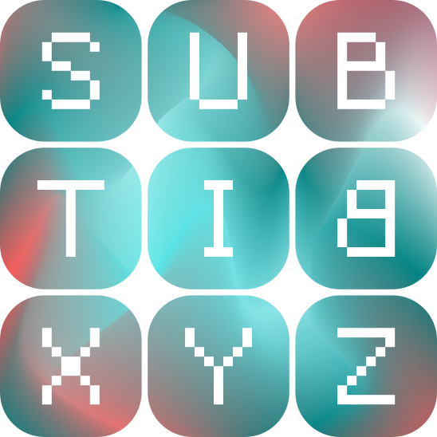
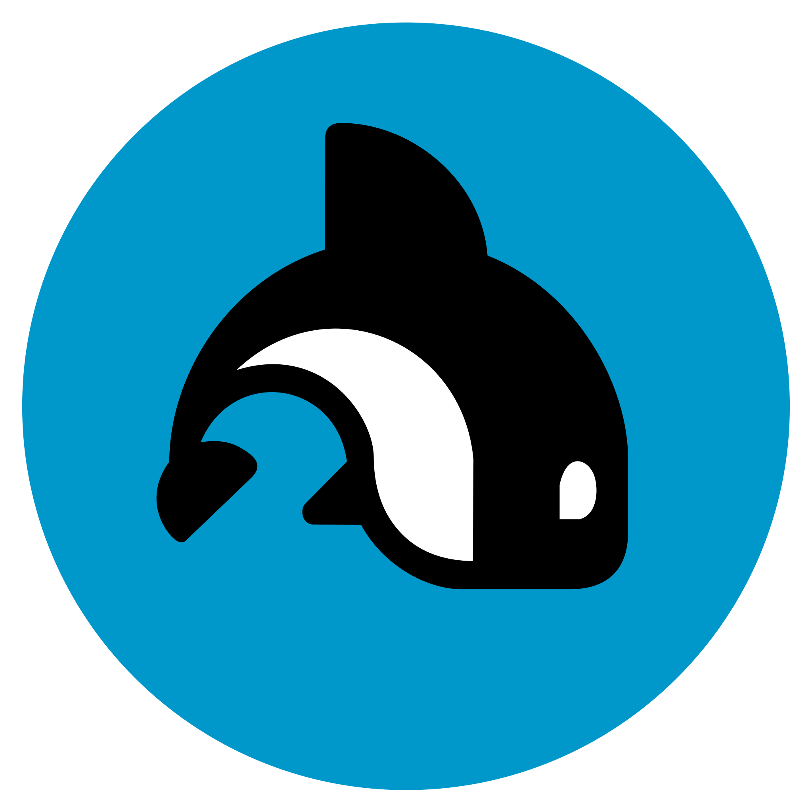

<div align="center">  </div>

# Subbit.xyz

> Cardano's Featherweight L2

## About

Subbit.xyz provides a tiny wrapper around services to make them _trustless
subscriptions_.

For more about Subbit.xyz, check out the [site](https://subbit.xyz) for an
overview.

Status: alpha, under active development towards
[x402](https://github.com/coinbase/x402) compliance alongside Subbit's native
("vanilla") dialect.

## Repo

This repo uses flakes. If you don't use flakes, you'll want Rust and Aiken on
path along with other dependencies -- see `flake.nix` for the full list.

```
$ tree -L 1
.
├── aiken     # Aiken on-chain validators
├── docs      # ADRs, design notes, glossary
├── examples  # Example integrations (echo demo, vanilla + x402)
├── packages  # Rust workspace: gate, cli, console, canary, etc.
├── xtask     # Workspace build/run helper tasks
├── flake.lock
└── flake.nix
```

## Orientation

- **`packages/`** -- the Rust workspace.
  - Provider side: `gate` (L2 request authentication/accounting, run as an axum
    service), `gate-client`, `claim` (settles channels on L1, spawned
    independently of `gate`), and the chain indexers `mock-index`/
    `naive-index`/`lineage-index`.
  - Consumer side: `console` (wallet + tx-building engine and CLI -- the
    shared library the CLI, wasm web UI, and `canary` all build on) and
    `stamp` (the client-side library that authenticates requests against a
    `gate`). `cli` is an older, now-largely-superseded consumer CLI, being
    folded into `console`.
  - Shared: `core`, `cost`, `config`, `tx`, `session`, `wallet`, `l1-dto`,
    `l2-dto`, `index-dto`, `build-info`.
  - Testing: `canary` (load-test/e2e harness against real Cardano preprod --
    see `canary-results.md`), `conformance` (Aiken/Rust cross-checks).
- **`docs/`** -- `adrs/` (design decisions and their rationale), `design/`
  and `designs/` (specs, some in-progress), `glossary.md` (shared
  terminology).
- **`examples/echo`** -- a minimal echo service, with and without Subbit
  wrapping it, in both the vanilla and x402 dialects.

## Building and running `canary`

`canary` spawns sibling binaries (`subbit-gate`, `lineage-index`,
`subbit-claim`) from its own target profile directory. Use the `xtask` alias to
build all four together:

```sh
cargo xtask build
cargo xtask build --release
```

`cargo xtask canary` builds first, then runs `canary` with any arguments after
`--` forwarded:

```sh
cargo xtask canary -- --help
cargo xtask canary -- init --config canary-config.toml
cargo xtask canary --release -- status --config canary-config.toml
```

See `cargo xtask --help` for the available options.

## Using Subbit.xyz

If you think Subbit.xyz is a good fit for your needs, please get in touch via
a github issue, or otherwise.

While we're still cooking is a great time to share potential applications.

Once we're ready, there will be docs and examples for self on-boarding.

## Catalyst & partners

Subbit.xyz was built with the support of a
[Project Catalyst](https://projectcatalyst.io) F13 proposal -- now concluded.
We're very grateful for that support, and for our partners and the wider
community who backed it along the way.





[Kompact.io](https://kompact.io) · [Orcfax](https://orcfax.io) ·
[Project Catalyst](https://projectcatalyst.io)
