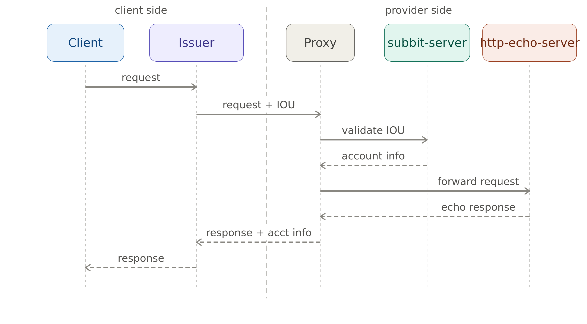

# Echo + Subbit

Here is a sequence diagram of the components.



Both wire dialects and all three cost models are demonstrated end to
end in `examples/echo/tests` (`cargo test -p subbit-examples-echo-tests`).

## Browser demo

`examples/echo/www/index.html` is a no-build-tool browser client against
`echo-server`'s `/echo`, `/echo/egress`, `/echo/claim` and the proxy's
terms relay, driving the vanilla dialect only (via `subbit-issuer`'s `wasm`
feature). No wallet needed: paste a 32-byte hex signing key into the UI.

Build its wasm bundle once (needs `wasm-pack`, already in the Nix dev
shell), then serve the directory as static files and open it:

```
examples/echo/www/build.sh
cd examples/echo/www && python3 -m http.server
```
